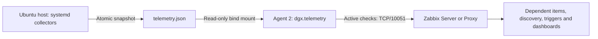

# DGX Spark / NVIDIA GB10 monitoring for Zabbix 7

**English** | [Español](docs/README.es.md)

## Repository layout

- [templates/](templates/): active/passive JSON exports to import into Zabbix.
- [scripts/](scripts/): host collector, export generator and dashboard definitions.
- [services/](services/): systemd jobs and timers for the Ubuntu host.
- [config/](config/): sample collector configuration.
- [docker/](docker/): minimal Compose, agent UserParameter and sample environment.
- [docs/](docs/): Spanish installation and reference guide.
- [tests/](tests/): collector and dashboard regression tests.
- `dist/`: generated ZIP, excluded from Git. Rebuild it using the command below.

Run installation and development commands from this project root. Repository
folders do not change paths already deployed on the Spark. The release ZIP
preserves the same folder structure; local configuration files are not packaged.

Host collector and standalone template for Ubuntu 24.04 ARM64: NVIDIA GB10,
unified RAM, CPU, sensors, filesystems, block IO, network, model caches and engine
endpoints. Export format **7.0**. Import **one** variant:
[active JSON](templates/template_dgx_spark_7_active.json) or
[passive JSON](templates/template_dgx_spark_7_passive.json). JSON is the only generated template format, avoiding duplicate exports.
Active/passive exports share UUIDs so the same template can be updated.

## Dashboard

| Overview widget | Meaning |
|---|---|
| Root filesystem pie | Used/free space on `/`. Free includes root-reserved blocks, so slices sum to total capacity. |
| Host uptime | Numeric host duration, not container uptime. |
| Detected engine endpoints | Configured IP:port endpoints seen up at least once, including those currently down. Not verified distinct products or loaded models. |
| Active engine endpoints | Previously detected endpoints currently responding to TCP. |
| Ports Honeycomb | Endpoint names/ports: green=1/UP, red=0/DOWN, independently of trigger delay. Never-seen endpoints do not appear. |
| Network IN/OUT | Two lines aggregated over selected physical interfaces by default. |
| RAM page cache | Host `Cached` from `/proc/meminfo`, distinct from cache directories on disk. |
| Sensor temperatures | Discovered hwmon/thermal plus NVIDIA temperatures in one graph, one series per item. |
| CPU load 15m | Linux load average, not CPU percentage. |
| Disk read/write | Two lines in bytes/s aggregated over selected physical devices by default. |
| Directory sizes | Configured, existing, measured paths sorted largest first, with allocated GiB, measurement age and status. Parent/child paths overlap. |
| CPU, power, snapshot age | Current KPIs; check snapshot age before interpreting frozen last-value colors. |

The **History and resource details** page retains CPU, RAM, GPU, energy and
storage graphs. Every discovered numeric metric also gets an individual graph.
The summary uses filesystem `/`, GPU index 0 and aggregate network/IO; discovery
still covers other filesystems, GPUs and interfaces.

## Dashboard examples

Screenshots supplied from a working deployment. Values and discovered resources
are examples captured at that time and vary by host and workload.

### 1. Overview: KPIs, filesystem and engine ports

Uptime, detected/active endpoints, 15-minute CPU load, RAM page cache, CPU usage,
NVIDIA-reported power and snapshot age, followed by the root filesystem pie chart
and the green/red TCP availability cells.


### 2. Network, disk IO, temperatures and directory sizes

Combined IN/OUT and read/write graphs, all discovered temperature series, and
monitored directories ranked by allocated size with measurement age and status.


### 3. History and resource details

CPU utilization, unified RAM, GPU temperature/utilization, reported watts and
estimated cumulative energy. The energy graph represents the NVIDIA-reported
power domain, not a wall-socket energy meter.


## Connection summary and host integration

### 4. Host view in Zabbix

The example host is enabled, with a green ZBX indicator, an agent interface on
TCP/10050, 183 entries under Latest data, 159 graphs and two dashboards.
Resource counts depend on discovery results and other templates linked to the
host; they are not fixed requirements of this template.


The data path for the supplied **active** Compose setup is:



The host collectors read NVIDIA, Linux resources and configured directories;
the container reads their JSON without direct GPU or host namespace access.
Zabbix extracts dependent items and automatically creates the discovered metrics
and graphs. TCP/10050 shown in the host row is the configured agent interface
used for **passive** checks. The supplied active-only Compose sends results to
the server/proxy on TCP/10051 and does not need TCP/10050 published.

## Architecture and requirements

[collector.py](scripts/collector.py) runs on the **Ubuntu host**, outside Docker. It reads
`/proc`, `/sys`, host filesystems and `nvidia-smi -q -x`, then atomically publishes
`/var/lib/dgx-spark/public/telemetry.json`. A separate job measures directories
every 30 minutes; large model trees cannot block minute telemetry. Agent 2 only
reads this JSON through a read-only directory mount.

Requirements: Python 3.10+ standard library, GNU `du`, installed NVIDIA driver
with `nvidia-smi`, systemd and a reachable Zabbix server/proxy. Host jobs run as
root to measure `/root/.cache` and inspect host processes. The agent keeps its
normal container user and needs no GPU or Docker socket access.

The reported server is 7.0.31. Zabbix's [compatibility matrix](https://www.zabbix.com/documentation/7.0/en/manual/appendix/compatibility)
requires Agent 2 not to be newer than the server release branch. Use Agent 2 7.0
with Server 7.0; Agent 2 7.4.15 is outside that supported combination. The example
image follows 7.0; pin a tested patch tag/digest for deployment. Future releases
require import validation.

## Upgrade a working installation

Update **both collector and template**: new widgets need additional summary fields.
Keep existing configuration, state and customized systemd units. Item keys, metric
IDs, graph UUIDs and template UUIDs are preserved for existing metrics.

```bash
# From the unpacked package, replace only the host collector executable.
sudo install -m 0755 scripts/collector.py /usr/local/lib/dgx-spark/collector.py
# Capture using the configuration path already set in your systemd service.
sudo systemctl start dgx-spark-collector.service
# Check for errors before importing the updated template.
sudo journalctl -u dgx-spark-collector.service -n 30 --no-pager
```

Reimport the same active/passive variant with **Create new** and **Update existing**
enabled for items, discovery rules, graphs, value maps and dashboards where offered.
Do not delete the host/history or replace local config with the example. Labels
update on the next capture and LLD run; unchanged discovery can be throttled for up
to one hour. Your custom config names remain your labels. Removed sensors can
retain old labels in the capability cache for seven days.

## Fresh installation on Ubuntu

Configuration can live beside Compose. The shipped units explicitly use
`/opt/dgx-spark/config.json`; `/etc/zabbix` is not required. For another folder,
change `--config` in **both** services and manual invocations. The CLI's legacy
default remains `/etc/zabbix/dgx-spark.json`; explicit `--config` overrides it.

Run from the unpacked package:

```bash
# Create executable, public state and local Compose/config directories.
sudo install -d -m 0755 /usr/local/lib/dgx-spark /var/lib/dgx-spark/public /opt/dgx-spark
# Install the host collector executable.
sudo install -m 0755 scripts/collector.py /usr/local/lib/dgx-spark/collector.py
# Create private config only if absent, preserving local settings.
test -e /opt/dgx-spark/config.json || sudo install -m 0600 config/config.example.json /opt/dgx-spark/config.json
# Review model/cache paths, ports and optional dashboard interface/disk selection.
sudo nano /opt/dgx-spark/config.json
# Install both collector jobs and their timers.
sudo install -m 0644 services/dgx-spark-collector.service services/dgx-spark-collector.timer services/dgx-spark-directories.service services/dgx-spark-directories.timer /etc/systemd/system/
# Perform the first directory scan; large model trees may take time.
sudo python3 /usr/local/lib/dgx-spark/collector.py --config /opt/dgx-spark/config.json --scan-directories
# Publish an initial host snapshot for the agent.
sudo python3 /usr/local/lib/dgx-spark/collector.py --config /opt/dgx-spark/config.json
# Reload systemd unit definitions.
sudo systemctl daemon-reload
# Enable minute captures and 30-minute directory scans after boot.
sudo systemctl enable --now dgx-spark-collector.timer dgx-spark-directories.timer
```

CPU, disk and network rates need two captures. Missing readings are omitted,
not replaced with zero. Each job is serialized to avoid overlapping invocations.

## Minimal Docker Compose agent

[compose.yaml](docker/compose.yaml) retains only what this template needs from the supplied
deployment. It uses **active checks**, outbound TCP/10051, with no incoming agent
port, privileged mode, NVIDIA runtime/devices, host namespaces or Docker socket.
The host collector supplies metrics. Preserve/add your existing TLS settings;
this minimal example does not configure TLS.

```bash
# Place Compose and the UserParameter beside collector configuration.
sudo install -m 0644 docker/compose.yaml docker/dgx-spark.conf /opt/dgx-spark/
# Create agent variables only if absent, preserving existing settings.
test -e /opt/dgx-spark/.env || sudo install -m 0600 docker/.env.example /opt/dgx-spark/.env
# Set exact Zabbix technical host name, reachable server/proxy and agent image.
sudo nano /opt/dgx-spark/.env
# Use the directory from which Compose resolves relative paths and .env.
cd /opt/dgx-spark
# Validate the resolved Compose before starting the container.
sudo docker compose config --quiet
# Start or recreate this Compose's agent service.
sudo docker compose up -d zabbix-agent2
# Verify that the agent can read the host snapshot.
sudo docker compose exec zabbix-agent2 zabbix_agent2 -t dgx.telemetry
```

Set `ZBX_HOSTNAME` in `.env` to the Zabbix **technical host name** and
`ZBX_SERVER_HOST` to your server/proxy. If the agent already exists, adapt its
current Compose instead of starting a second container with the same name.
The essential mounts are:

```yaml
volumes:
  # Mount the directory, not the inode replaced by atomic JSON writes.
  - /var/lib/dgx-spark/public:/var/lib/dgx-spark/public:ro
  # Include the fixed command used to read telemetry.
  - ./dgx-spark.conf:/etc/zabbix/zabbix_agent2.d/dgx-spark.conf:ro
```

The only new agent setting is:

```ini
# Read output without sudo, dynamic arguments or host namespace access.
UserParameter=dgx.telemetry,cat /var/lib/dgx-spark/public/telemetry.json
```

For a native agent, install it in the included config directory and restart Agent 2.
For passive checks, enable passive connections, publish `10050:10050`, configure a
reachable agent interface in Zabbix and import the passive variant. Active checks
do not need incoming TCP/10050. The old `gpu.*` template is separate; unlink it if
its unsupported-memory/fan errors are no longer wanted.

## Engine endpoints and IO selection

Defaults: Ollama 11434 (`/api/version`), vLLM/LLM API 8000 (TCP only), ComfyUI 8188
(`/system_stats`), llama.cpp 8080/9931 (`/health`, version-dependent), LM Studio 1234
(`/v1/models`), SGLang 30000 (`/health`), TensorFold 8888 (TCP only, user-supplied
port). Ports are candidates, not proof of engine identity. No full port scan occurs.
Add/replace entries in your config:

```json
{"name":"Custom vLLM", "host":"127.0.0.1", "port":18000,
 "health_path":"/health", "timeout":1, "ok_codes":[200]}
```

One profile per numeric IP:port, maximum 64 endpoints. Remove `health_path` for
TCP-only checks. HTTP 401/403 are not healthy by default: use a public health
endpoint or `token_env` and a protected systemd environment file. No redirects or
ambient proxy are used. Container service ports must be published/reachable from
the host. Discovery follows the first successful TCP check; configured endpoints
remain monitored while down. Use maintenance for planned outages. A health GET
does not prove real inference works; no synthetic inference is executed.

`dashboard_interfaces` and `dashboard_disks` select names for aggregate graphs,
for example `["enp1s0"]` and `["nvme0n1"]`. Empty lists select physical devices.
Exclusions still apply. Selected names appear in `dgx.inventory`; unavailable or
empty selections omit summary rates rather than invent zeros. Avoid adding
logical devices and their backing devices, or bridges plus their members.

## Measurements, alerts and limitations

- GB10 memory is unified. NVIDIA `N/A`/`Not Supported` are omitted. Per-process GPU
  memory is separate; never add it to RAM or label it total dedicated VRAM.
- Power is NVIDIA's reported domain, not guaranteed whole-host wall power. Energy
  uses persisted trapezoidal integration. Reboots and gaps over 180s are excluded;
  short gaps are interpolated. Deleting state resets accumulated kWh.
- Sensor labels/domains come from Linux. CPU temperature is available only when
  exposed. hwmon/thermal may expose duplicate sensors; do not sum power sources.
- Cache paths include root cache, Hugging Face and Ollama defaults; configure actual
  `HF_HOME`, `OLLAMA_MODELS` and host bind-mount origins. `du -s -B1 -x` reports
  allocated bytes without crossing filesystems/following symlinks. Ranking covers
  configured, measured, existing paths, not a full-disk search. Failed scans retain
  previous size with failure/age. Ranking STALE status uses fixed 5400s; alert
  macros are adjustable. Nested directory sizes overlap and must not be summed.
- Process-group CPU/RSS are command-pattern estimates including children, not exact
  per-container/port billing. Shared RSS may repeat. No per-engine watts, tokens/s,
  queue or KV-cache metrics are inferred. TensorFold process matching is configurable.
- Block IO includes throughput/latency; NVMe SMART wear/error health is not collected.
- Capabilities persist for seven days through missing readings; then Zabbix's
  lost-resource policy applies (30-day deletion). No-reading warnings default to
  15 minutes. Removing a profile differs from an outage of a configured service.

Warning/recovery defaults: RAM 90/85%, CPU 95/85%, swap 80/70%, temperatures 85/80 C,
NVIDIA power 150/140 W, filesystem 85/80%, inodes 90/85%, directory share 50/45%,
group RSS 90/80%, TCP connection time 0.8/0.5s, directory age 5400/3600s. GPU 100%
alone does not alert. Group CPU 101% effectively disables routine warnings. Power
and temperatures are administrative proposals, not manufacturer specifications;
review per sensor. CPU saturation may be expected during AI workloads.

`{$DGX.WINDOW}`=5m requires at least three samples, all beyond threshold. This is
not continuous coverage if samples are missing. Recovery thresholds are separate.
`{$DGX.STALE}`=5m raises a global High warning for stale snapshots and suppresses
other threshold/missing-metric warnings. Snapshot-age widget turns red at a fixed
300s; adjust it if changing that macro. Honeycomb last values can remain frozen
while the collector is down.

Per-item contexts override globals: `{$DGX.FS.WARN:"ID"}` and
`{$DGX.FS.WARN.RECOVERY:"ID"}`. ID is the second argument in the discovered item key.
Use macros/LLD overrides, not manual edits to generated items. Coordinate the host
timer and `{$DGX.INTERVAL}` when changing collection frequency.

## Import and verify

1. Import one variant under Data collection → Templates.
2. Link `DGX Spark GB10 by host collector` to your existing host; no other template
   is linked automatically. Use the active variant with the supplied Compose.
3. Check `dgx.timestamp`, `dgx.diagnostics`, `dgx.inventory` and discovery results;
   wait for two captures for rates and check snapshot age.
4. Open the host template dashboard. Summary/individual graphs can be selected in
   global dashboards. Ports and sensors are discovered dynamically.
5. Stop/restart a known engine: its port color should change red/green; its trigger
   follows the configured sustained interval.

```bash
# Inspect complete driver capabilities and reported power fields.
nvidia-smi -q -x
# Cross-check GPU temperature, watts and utilization against dashboard values.
nvidia-smi --query-gpu=temperature.gpu,power.draw,utilization.gpu --format=csv,noheader,nounits
# Capture with the config path already set in the service.
sudo systemctl start dgx-spark-collector.service
# Inspect both fast and slow collector logs.
sudo journalctl -u dgx-spark-collector.service -u dgx-spark-directories.service -n 50 --no-pager
# Inspect summary, sorted directory data and selected devices.
python3 -m json.tool /var/lib/dgx-spark/public/telemetry.json
# Confirm the actual host TCP listeners.
ss -ltn
```

If host linking fails with `Graph "DGX: {#LABEL}" already exists`, reimport this
release with discovery rules/graphs updated. Prototype names include rule and ID
to avoid [ZBX-26421](https://support.zabbix.com/browse/ZBX-26421). No host/history
deletion is required.

## Development

Host execution needs only Python standard library. Export generation also uses only the Python standard library. UUIDs are deterministic; the generator refreshes both variants and ZIP.

```bash
# Test unavailable values, power, services, IO aggregation and dashboard invariants.
python -m unittest discover -s tests -v
# Regenerate active/passive JSON and the structured distribution ZIP.
python -m scripts.build_template
```

Local tests do not replace import/visual verification of the expanded dashboard on
your Zabbix server. Widgets are native Zabbix 7.0: piechart, item, honeycomb, graph,
svggraph and itemhistory. No frontend plugin is required.

## Official references

- [NVIDIA memory limitations](https://docs.nvidia.com/dgx/dgx-spark/known-issues.html).
- [NVIDIA power reporting](https://docs.nvidia.com/deploy/nvidia-smi/).
- [Zabbix 7.0 export](https://www.zabbix.com/documentation/7.0/en/manual/xml_export_import/templates).
- [Zabbix 7.0 pie chart](https://www.zabbix.com/documentation/7.0/en/manual/web_interface/frontend_sections/dashboards/widgets/pie_chart).
- [Zabbix 7.0 widget implementation](https://github.com/zabbix/zabbix/tree/release/7.0/ui/widgets).
- [TensorFold](https://tensorfold.ai/) (port 8888 supplied by the user).
