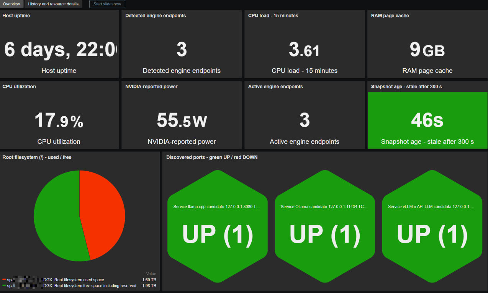
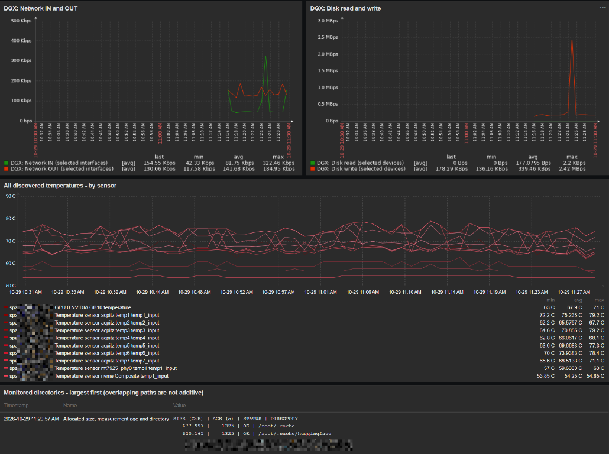
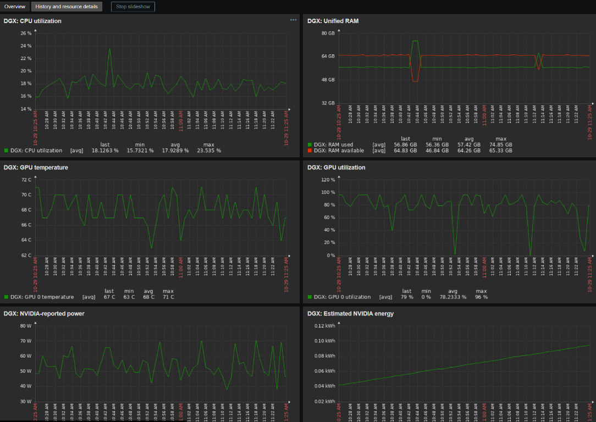
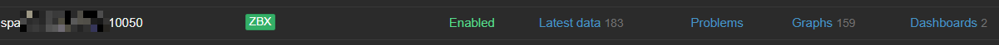
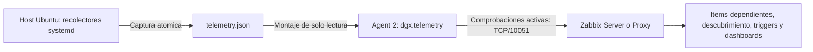

# DGX Spark / NVIDIA GB10 para Zabbix 7

[English](../README.md) | **Español**

## Estructura del proyecto

- [templates/](../templates/): exportables JSON activo y pasivo para Zabbix.
- [scripts/](../scripts/): recolector, generador y definicion del dashboard.
- [services/](../services/): servicios y timers systemd del host Ubuntu.
- [config/](../config/): configuracion de ejemplo del recolector.
- [docker/](../docker/): Compose minimo, UserParameter y variables de ejemplo.
- [docs/](./): documentacion en español.
- [tests/](../tests/): pruebas de recogida y dashboard.
- `dist/`: ZIP generado; no se guarda en Git y se regenera con el comando indicado.

Ejecutar los comandos desde la raiz de este proyecto, tambien tras extraer el ZIP.
Las carpetas del repositorio no cambian las rutas ya desplegadas en el Spark.
Solo se generan JSON para simplificar; ya no hay copias YAML ni dependencia de
PyYAML. El ZIP conserva la estructura de carpetas y excluye configuraciones locales.

## Dashboard ampliado y actualizacion

### Capturas de ejemplo

Capturas aportadas desde un despliegue funcional. Los valores y recursos
descubiertos corresponden a ese momento y cambian segun el equipo y la carga.

**1. Vista general: indicadores, filesystem y puertos.** Uptime, endpoints
detectados/activos, carga 15m, page cache, CPU, potencia NVIDIA y edad de captura;
debajo, la tarta del disco raiz y las celdas de disponibilidad TCP verde/rojo.



**2. Red, disco, sensores y directorios.** Graficos conjuntos IN/OUT y
lectura/escritura, temperaturas por sensor y rutas monitorizadas ordenadas por
tamaño asignado, con edad y estado de la medicion.



**3. Historico y detalle de recursos.** CPU, RAM unificada, temperatura y uso de
GPU, potencia reportada y energia acumulada estimada. Esa energia corresponde
al dominio de potencia NVIDIA, no a una medicion del equipo en el enchufe.



### 4. Resumen de conexion e integracion del host

La ficha de ejemplo muestra el host habilitado, indicador ZBX verde, interfaz
del agente en TCP/10050, 183 entradas en Latest data, 159 graficos y dos dashboards.
Los recuentos dependen del descubrimiento y de otras plantillas
vinculadas; no son cantidades fijas exigidas por esta plantilla.



El recorrido de los datos con el Compose **activo** incluido es:



Los recolectores leen NVIDIA, recursos Linux y rutas configuradas en el host.
El contenedor solo lee su JSON, sin acceso directo a GPU ni a los espacios de
nombres del host. Zabbix extrae los items dependientes y crea las metricas y
graficos descubiertos. El TCP/10050 visible en la ficha es la interfaz configurada
para comprobaciones **pasivas**. El Compose activo incluido envia resultados
al servidor/proxy por TCP/10051 y no necesita publicar TCP/10050.

### Funciones y actualizacion

La plantilla se distribuye en ingles. El dashboard incluye tarta usado/libre de
`/`, uptime, endpoints de motores detectados y activos, carga 15m, page cache,
edad de captura, puertos Honeycomb verde/rojo, red IN/OUT en dos lineas,
lectura/escritura en dos lineas, temperaturas por sensor en un grafico y rutas
monitorizadas ordenadas de mayor a menor tamaño. La segunda pagina conserva el
historico. El contador detectado incluye endpoints IP:puerto configurados vistos
al menos una vez, aunque esten caidos; no cuenta modelos ni verifica productos.
El activo cuenta conexiones TCP actuales. El color refleja el ultimo TCP sin
esperar al trigger; puede quedar congelado si falla la recogida: revisar su edad.

La tarta incluye reserva libre root y suma el total real de `/`. Page cache es
`Cached` de RAM, no `/root/.cache`. Red/disco agregan fisicos por defecto para
evitar doble contabilizacion; elegir nombres en `dashboard_interfaces` y
`dashboard_disks` si se desea. Listas vacias seleccionan fisicos automaticamente.
Las exclusiones siguen aplicandose. Ver seleccion en `dgx.inventory`. Las tasas
necesitan dos capturas. El listado cubre rutas configuradas, existentes y medidas,
no todo el disco; tamaños padre/hijo se solapan. Muestra tamaño, edad y estado;
STALE informativo usa 5400s y la alerta admite macros. hwmon/thermal pueden exponer
el mismo sensor por duplicado en el grafico de temperaturas.

**Actualizar una instalacion que funciona:** conservar config, estado y unidades
personalizadas, y actualizar tanto el recolector como la plantilla. Los nuevos
widgets necesitan nuevos campos del JSON. Claves y UUID anteriores se conservan.
Nombres configurados por ti siguen siendo tuyos; sensores retirados pueden
mantener nombres anteriores siete dias. La validacion visual se hace en Zabbix.

```bash
# Desde la carpeta del paquete, actualizar solo el ejecutable del host.
sudo install -m 0755 scripts/collector.py /usr/local/lib/dgx-spark/collector.py
# Capturar con la configuracion que ya utiliza tu unidad systemd.
sudo systemctl start dgx-spark-collector.service
# Revisar errores antes de reimportar el dashboard.
sudo journalctl -u dgx-spark-collector.service -n 30 --no-pager
```

Reimportar la misma variante con **Crear nuevos** y **Actualizar existentes**
para items, descubrimientos, graficos, mapas de valores y dashboards donde se
ofrezcan esas opciones. No borrar el host/historico ni reemplazar la config local.

Plantilla independiente con formato de exportacion 7.0, recolector para Ubuntu
24.04/ARM64 y Agent 2 nativo o en contenedor. Se generan variantes activa y pasiva.
**Importar solo una variante**: comparten nombre y UUID para poder actualizarla.
Las versiones futuras requieren comprobar su importador; no se garantiza una
compatibilidad ilimitada. Entorno comunicado: **Zabbix Server 7.0.31** y
**Zabbix Agent 2 7.4.15**. El formato sigue siendo **7.0**, porque lo importa el
servidor. Esas versiones describen el destino, no una prueba de importacion o de
comunicacion ya realizada. El archivo activo usa comprobaciones activas; elegirlo
solo si `ServerActive` y el hostname del agente estan configurados para ese modo.

**Compatibilidad del agente:** la [matriz oficial de Zabbix 7.0](https://www.zabbix.com/documentation/7.0/en/manual/appendix/compatibility)
indica que Agent 2 no debe ser mas nuevo que 7.0. La combinacion comunicada
Server 7.0.31 + Agent 2 7.4.15 queda fuera de esa compatibilidad soportada aunque
algunas consultas puedan funcionar. Para mantener el servidor 7.0, usar Agent 2
de la rama 7.0, preferiblemente una version de mantenimiento fijada. La plantilla
no cambia la imagen del contenedor. El formato 7.0 del exportable no corrige por
si solo una diferencia de versiones entre servidor y agente.

## Archivos

- [Plantilla pasiva JSON](../templates/template_dgx_spark_7_passive.json).
- [Plantilla activa JSON](../templates/template_dgx_spark_7_active.json).
- Solo se generan JSON para evitar exportables duplicados.
- [Recolector](../scripts/collector.py), solo biblioteca estandar de Python 3.10+.
- [Configuracion de ejemplo](../config/config.example.json).
- [UserParameter](../docker/dgx-spark.conf).
- Servicios y timers systemd: capturas cada minuto; carpetas cada 30 minutos.
- [Generador](../scripts/build_template.py) y [pruebas](../tests/test_collector.py).

## Modelo de recogida y limites

El recolector se ejecuta en el **host Ubuntu**, fuera de Docker. Lee `/proc`,
`/sys`, los sistemas de archivos del host y `nvidia-smi -q -x`.
Publica un unico JSON mediante sustitucion atomica. El agente solo necesita leer
ese JSON; no necesita acceso a GPU, PID del host, Docker socket, sudo ni root.
No se enlaza automaticamente la plantilla oficial Linux, porque sus claves
ejecutadas dentro de un contenedor pueden describir el contenedor.

Se descubren las metricas numericas que existen, con grafico individual y alerta
de ausencia de muestras durante 15 minutos. Se conservan capacidades durante
7 dias ante fallos transitorios. Si desaparecen del descubrimiento despues de ese
plazo, se aplica la politica de recursos perdidos de Zabbix (eliminacion a 30 dias).
Los datos ausentes se descartan; nunca se convierten en cero.

- CPU: uso global entre capturas, cargas 1/5/15m, nucleos y frecuencias si existen.
- RAM unificada: total, disponible, libre estricta, ocupada definida como
  `MemTotal - MemAvailable`, cache, buffers, swap y presion PSI si existe.
  El primer uso de CPU/IO/red necesita una segunda captura; no se inventa un cero.
- GPU: nombre, UUID, driver, P-state en inventario, temperatura, utilizacion,
  actividad del controlador de memoria, potencia, limites y frecuencias soportados.
  Memoria framebuffer y ventilador solo si NVIDIA entrega numeros.
  La suma de memoria de procesos GPU es otra metrica, no el total de VRAM ni
  memoria que deba sumarse a la RAM. No se prometen contadores no expuestos.
- Sensores: todas las temperaturas, ventiladores RPM y potencias disponibles en
  hwmon; tambien thermal zones. El nombre procede del kernel: no se etiqueta como
  CPU un sensor que no identifique su dominio. Puede haber lecturas duplicadas
  del mismo sensor via thermal/hwmon, que no deben sumarse.
- Sistemas de archivos locales: bytes totales, ocupados, libres y disponibles,
  porcentaje ocupado e inodos. Se excluyen sistemas virtuales y overlay Docker.
  El porcentaje usa capacidad utilizable por usuarios, descontando reserva root.
- Dispositivos de bloque completos: lectura/escritura, tiempo ocupado, latencia
  media de IO completadas y IO en curso. Incluye NVMe presentes en `/proc/diskstats`.
  El tiempo ocupado es un indicador de actividad, no una medida exacta de
  saturacion de un NVMe paralelo. No incorpora SMART, desgaste ni errores NVMe;
  para ello hace falta una extension con nvme-cli/smartctl y comprobar su salida.
- Red: RX/TX, errores y descartes. Se omiten loopback y veth/docker/br por defecto.
- Procesos: grupos por patrones configurables, con hijos, CPU normalizada al
  conjunto de nucleos y suma RSS. Son aproximaciones por motor, no contabilidad
  exacta por contenedor, servicio o puerto. RSS puede contar paginas compartidas
  varias veces; no sumar grupos si se solapan. No se atribuyen vatios a procesos.
- No se recogen tokens/s, cola de inferencia o KV cache: requieren integrar la API
  de metricas propia de cada motor, que cambia entre productos y versiones.

## Potencia y energia

En la salida aportada, **43 W es una lectura valida**, mientras que el limite de
potencia figura como N/A. El recolector admite `power_draw`,
`average_power_draw` y el XML antiguo `power_readings`. El dashboard se denomina
"Potencia reportada NVIDIA": no garantiza que mida CPU + SSD + red ni perdidas
de la fuente. Para consumo total del equipo en el enchufe se necesita un medidor
externo. No sumar potencia hwmon y NVIDIA sin conocer sus dominios.

La energia estimada usa integracion trapezoidal:
`kWh += (W_anterior + W_actual)/2 * segundos / 3600000`.
Se conserva en el estado del host. Omite intervalos mayores de 180 segundos y
cambios de arranque; no estima energia durante apagados o caidas largas. Los
huecos cortos se interpolan. Es un acumulador desde la instalacion, no una lectura
fiscal ni automaticamente un consumo mensual. Eliminar el estado reinicia el
acumulador. El dashboard resume la primera GPU; el descubrimiento cubre todas.

## Instalacion en el host Ubuntu

Copiar esta carpeta al Spark y ejecutar desde ella. Los comandos **instalan y
activan tareas locales**. No se han ejecutado contra tu Spark desde este proyecto.
Se necesitan Python 3, GNU coreutils (`du`) y `nvidia-smi` del driver ya instalado.
Revisar primero [config.example.json](../config/config.example.json) y las rutas reales.

```bash
# Crear ejecutables/estado y una carpeta para Compose y configuracion en Ubuntu.
sudo install -d -m 0755 /usr/local/lib/dgx-spark /var/lib/dgx-spark/public /opt/dgx-spark
# Instalar el recolector que se ejecuta fuera de Docker.
sudo install -m 0755 scripts/collector.py /usr/local/lib/dgx-spark/collector.py
# Crear config solo si no existe; mantener los ajustes locales anteriores.
test -e /opt/dgx-spark/config.json || sudo install -m 0600 config/config.example.json /opt/dgx-spark/config.json
# Revisar rutas, puertos y seleccion de interfaces/discos.
sudo nano /opt/dgx-spark/config.json
# Instalar tareas y timers: estas unidades usan /opt/dgx-spark/config.json.
sudo install -m 0644 services/dgx-spark-collector.service services/dgx-spark-collector.timer services/dgx-spark-directories.service services/dgx-spark-directories.timer /etc/systemd/system/
# Medir las carpetas por primera vez; puede tardar con modelos grandes.
sudo python3 /usr/local/lib/dgx-spark/collector.py --config /opt/dgx-spark/config.json --scan-directories
# Generar la primera captura para el agente.
sudo python3 /usr/local/lib/dgx-spark/collector.py --config /opt/dgx-spark/config.json
# Recargar las definiciones systemd.
sudo systemctl daemon-reload
# Activar capturas cada minuto y medicion de carpetas cada 30 minutos.
sudo systemctl enable --now dgx-spark-collector.timer dgx-spark-directories.timer
```

El recolector corre como root para leer `/root/.cache` y procesos del host; la
imagen del agente mantiene su usuario habitual. Los servicios usan sistema de
archivos de solo lectura salvo su directorio de estado. Las unidades no ocultan
`/root`, `/home`, `/proc`, `/sys` ni los dispositivos NVIDIA.

## Integracion con el contenedor Agent 2

La config vive junto a Compose en `/opt/dgx-spark/config.json`. `/etc/zabbix` no
es obligatorio en el host. Para otra ruta, cambiar `--config` en ambas unidades
y ejecuciones manuales. El CLI conserva `/etc/zabbix/dgx-spark.json` por defecto
solo para compatibilidad; las unidades nuevas pasan la ruta explicitamente.

Para una instalacion nueva usar [compose.yaml](../docker/compose.yaml) y [.env.example](../docker/.env.example).
Solo esta plantilla activa: sin privilegios, runtime NVIDIA, socket Docker,
montajes de `/proc`/`/sys`/`/dev`, ni puerto entrante 10050. El agente lee resultados
del host. Si ya existe un agente, adaptar su Compose para no crear otro con el
mismo nombre. Conservar o añadir los ajustes TLS de tu instalacion.

```bash
# Copiar el Compose minimo y el UserParameter junto a la configuracion del host.
sudo install -m 0644 docker/compose.yaml docker/dgx-spark.conf /opt/dgx-spark/
# Crear variables solo si no existen; no pisar las anteriores.
test -e /opt/dgx-spark/.env || sudo install -m 0600 docker/.env.example /opt/dgx-spark/.env
# Definir hostname tecnico exacto y servidor/proxy reales; revisar la imagen 7.0.
sudo nano /opt/dgx-spark/.env
# Usar el directorio desde el que Compose resuelve rutas relativas.
cd /opt/dgx-spark
# Validar antes de crear el contenedor.
sudo docker compose config --quiet
# Iniciar o recrear el agente de este Compose.
sudo docker compose up -d zabbix-agent2
# Verificar el acceso al JSON desde el agente.
sudo docker compose exec zabbix-agent2 zabbix_agent2 -t dgx.telemetry
```

Modo pasivo: permitir pasivo, publicar `10050:10050`, definir la interfaz alcanzable
en Zabbix e importar la variante pasiva. No hace falta para modo activo.

Anadir estas dos entradas a `volumes` del servicio **existente** de Agent 2:

```yaml
volumes:
  - /var/lib/dgx-spark/public:/var/lib/dgx-spark/public:ro
  - ./dgx-spark.conf:/etc/zabbix/zabbix_agent2.d/dgx-spark.conf:ro
```

La ruta izquierda de `./dgx-spark.conf` debe ser relativa al compose real, o una
ruta absoluta donde se haya copiado ese archivo al host. Montar el **directorio**
publico completo: montar unicamente `telemetry.json` dejaria de ver las futuras
sustituciones atomicas. Comprobar que la configuracion principal incluye
`/etc/zabbix/zabbix_agent2.d/*.conf`. Conservar las variables actuales de servidor,
hostname, TLS, red y puertos; no se suministra un compose que las sustituya.

El unico UserParameter nuevo es:

```ini
UserParameter=dgx.telemetry,cat /var/lib/dgx-spark/public/telemetry.json
```

Recrear el servicio despues de modificar sus montajes, con su nombre real:

```bash
# Recrear el agente existente tras modificar los montajes.
docker compose up -d NOMBRE_SERVICIO_AGENT2
# Probar la clave del recolector dentro del contenedor.
docker compose exec NOMBRE_SERVICIO_AGENT2 zabbix_agent2 -t dgx.telemetry
```

Si el agente es nativo, copiar ese mismo archivo a su directorio de inclusiones y
reiniciar Agent 2. No conservar la plantilla anterior enlazada si se quiere dejar
de ver sus errores `gpu.free`/`gpu.fanspeed`. Las nuevas claves tienen prefijo
`dgx.` y no requieren los UserParameters antiguos. La retirada de los parametros
antiguos debe coordinarse con los otros hosts/plantillas que todavia los usen.

## Puertos y servicios

Los perfiles iniciales son candidatos, no identificacion por inspeccion del
proceso. Un puerto abierto puede pertenecer a otro programa: editar su etiqueta
y health check para el uso real. No se hace un barrido de todos los puertos.

| Candidato | Puerto inicial | GET opcional |
|---|---:|---|
| Ollama | 11434 | `/api/version` |
| vLLM u otra API LLM | 8000 | desactivado hasta confirmar motor; vLLM suele usar `/health` |
| ComfyUI | 8188 | `/system_stats` |
| llama.cpp | 8080 y 9931 | `/health`; puerto dependiente de version/arranque |
| LM Studio | 1234 | `/v1/models` |
| SGLang | 30000 | `/health` |
| TensorFold | 8888 | solo TCP; endpoint HTTP de salud pendiente de confirmar |

[TensorFold](https://tensorfold.ai/) es el producto indicado por el usuario; su
puerto 8888 procede de su configuracion comunicada. No se equipara a TensorRT-LLM
ni NIM. Se descubre disponibilidad TCP y tiempo de conexion en 8888, conservando
el servicio una vez observado para poder alertar de su caida. No se presupone
una ruta `/health` ni compatibilidad OpenAI. El patron de procesos `tensorfold`
es configurable y solo aporta CPU/RSS si el comando real contiene ese nombre;
el descubrimiento TCP funciona independientemente de ese patron.

Para un puerto personalizado, anadir o reemplazar un perfil:

```json
{"name":"vLLM propio", "host":"127.0.0.1", "port":18000,
 "health_path":"/health", "timeout":1, "ok_codes":[200]}
```

Una entrada por direccion IP:puerto, IPv4 o IPv6 numerica. Hasta 64 endpoints,
con timeouts de 1 segundo por defecto, concurrencia limitada y sin proxy ni
redirecciones. Para APIs con autenticacion se admite `token_env` y un archivo
de entorno systemd protegido (no se guardan tokens en el JSON publico).
Si solo se desea TCP, eliminar `health_path`. Un 401/403 no es salud correcta
por defecto: configurar autenticacion, endpoint publico o limitarse a TCP.

Se registra un servicio **solo tras la primera conexion TCP correcta**. Despues
continua publicandose su estado incluso si cae. TCP y HTTP son alertas separadas;
una API que responde 503 puede estar cargando un modelo o averiada. La ventana
predeterminada de 5 minutos filtra fallos breves; ajustar para modelos lentos.
Un GET de salud no ejecuta una inferencia ni demuestra que todo el motor funcione.

Los puertos de contenedores deben estar publicados en el host o tener una IP
alcanzable desde el host. Para retirar un servicio definitivamente, quitar su
perfil: las capacidades se conservan 7 dias y despues aplica la vida de recursos
perdidos. Para una pausa planificada usar mantenimiento de Zabbix.

## Carpetas y modelos

Rutas iniciales: `/root/.cache`, Hugging Face bajo esa carpeta, modelos Ollama
de root y del servicio, y patrones en `/home/*`. Agregar `HF_HOME`,
`HUGGINGFACE_HUB_CACHE`, `OLLAMA_MODELS`, bind mounts u otras rutas reales.
La `.cache` de un contenedor no es necesariamente la del host: configurar la
ruta de origen de su volumen. No se inspecciona Docker socket.

Se usa `du -s -B1 -x`: espacio asignado, sin atravesar otros sistemas de archivos
ni seguir enlaces simbolicos. Una ruta ausente muestra existencia=0, no un tamaño
falso de cero. Una ruta parcialmente ilegible o que agote el tiempo conserva el
ultimo tamaño valido, con estado de fallo y edad de la medicion. El timeout de
90s por ruta es configurable. La tarea lenta tiene un limite total de 15 minutos.
Raiz y subcarpetas se solapan: **no sumar sus tamaños**. No se borra ninguna cache.

## Importar y personalizar en Zabbix

### Actualizacion que corrige el conflicto al vincular un host

Si aparece `Graph "DGX: {#LABEL}" already exists`, volver a importar el
exportable actualizado de la misma variante activa/pasiva. Activar la actualizacion
de elementos existentes para reglas de descubrimiento y graficos, y la creacion
de nuevos elementos. Guardar la importacion antes de volver a vincular la
plantilla al host. Los UUID se conservan para actualizar los prototipos existentes;
no hace falta borrar el host ni su historico ni reinstalar el recolector.

Los nombres de prototipos ahora incluyen su regla y el ID de la metrica, por
ejemplo `DGX gpu.GPU.TEMP.WARN: {#LABEL} [{#ID}]`. Se evita tanto la repeticion
literal entre reglas como la repeticion de etiquetas al descubrir sensores.
La limitacion de herencia corresponde al [incidente ZBX-26421](https://support.zabbix.com/browse/ZBX-26421).

### Instalacion inicial

1. Importar la variante activa o pasiva desde Recopilacion de datos → Plantillas.
2. Vincular `DGX Spark GB10 by host collector` al host existente. No enlaza otras
   plantillas ni cambia la configuracion del servidor o del agente.
3. Activo: hostname del agente debe coincidir con el host y ServerActive apuntar
   al servidor/proxy. Pasivo: interfaz del agente alcanzable desde servidor/proxy
   y conexiones entrantes permitidas por su configuracion actual.
4. Comprobar `dgx.telemetry`, `dgx.timestamp`, `dgx.diagnostics` y los descubrimientos.
5. Abrir el dashboard del host. Los graficos individuales descubiertos se pueden
   seleccionar en widgets de dashboards generales de Zabbix.

Umbrales iniciales propuestos (severidad Warning; disponibilidad Average):

| Metrica | Problema sostenido | Recuperacion |
|---|---:|---:|
| RAM ocupada / total menos disponible | >90% | <=85% |
| CPU total | >95% | <=85% |
| Swap ocupada | >80% | <=70% |
| GPU y otros sensores de temperatura | >85 C | <=80 C |
| Potencia reportada NVIDIA | >150 W | <=140 W |
| Sistemas de archivos ocupados | >85% | <=80% |
| Inodos ocupados | >90% | <=85% |
| Carpeta / capacidad de disco | >50% | <=45% |
| Edad de medicion de carpeta | >5400s | <=3600s |
| RSS del grupo / RAM total | >90% | <=80% |
| CPU del grupo | >101% (sin alerta habitual) | <=95% |
| TCP y salud HTTP | 0 sostenido | 1 |
| Tiempo de conexion TCP | >0.8s | <=0.5s |

Temperaturas y potencia son **valores administrativos provisionales**, no limites
certificados del GB10 ni de todos sus sensores. Revisarlos con el hardware real.
Un limite de fuente de 240W o TDP de SoC no equivale al dominio de `power.draw`.
No hay trigger por GPU al 100%: durante inferencia es un funcionamiento esperado.
Para CPU al 100% normal, elevar el umbral global sobre 100 o desactivar su trigger.

Macros globales: `{$DGX.WINDOW}`=5m, `{$DGX.STALE}`=5m,
`{$DGX.METRIC.STALE}`=15m, `{$DGX.INTERVAL}`=1m. Las alarmas de umbral necesitan
al menos 3 muestras y que todas las muestras de la ventana excedan el umbral.
No son prueba de cobertura continua si faltan algunas muestras. Para cambiar
intervalos, coordinar timer y macro; ventanas menores de 3 capturas no alertaran.
La antiguedad de captura suprime las alertas de umbral/metricas y genera una
alerta global High, evitando presentar valores congelados como actuales.

Cada umbral tiene macro de recuperacion, por ejemplo `{$DGX.FS.WARN}` y
`{$DGX.FS.WARN.RECOVERY}`. Se admiten contextos por ID para excepciones de un
disco/sensor/servicio: `{$DGX.FS.WARN:"ID"}`=92. El ID es el segundo argumento
de la clave del item descubierto. Sin contexto especifico se usa la macro global.
No editar a mano items descubiertos: usar macros u overrides del descubrimiento.

## Comprobacion en el Spark

```bash
# Ver las capacidades y lecturas completas anunciadas por el driver.
nvidia-smi -q -x
# Contrastar temperatura, potencia y uso con los items del dashboard.
nvidia-smi --query-gpu=temperature.gpu,power.draw,utilization.gpu --format=csv,noheader,nounits
# Solicitar una captura con la config actual de la unidad.
sudo systemctl start dgx-spark-collector.service
# Consultar registros de ambas tareas.
sudo journalctl -u dgx-spark-collector.service -u dgx-spark-directories.service -n 50 --no-pager
# Inspeccionar resultados e inventario de interfaces/discos seleccionados.
python3 -m json.tool /var/lib/dgx-spark/public/telemetry.json
# Comprobar los puertos TCP que escuchan realmente en el host.
ss -ltn
```

El JSON contiene etiquetas de sensores, inventario y diagnostico. Verificar que
los W de la GPU coinciden aproximadamente con la consulta directa; pequenas
diferencias son normales si se ejecutan en momentos diferentes. Comparar con un
medidor externo si se necesita potencia total real.

Prueba operativa: iniciar un motor, esperar su descubrimiento, detenerlo y esperar
5 minutos; debe alertar y recuperarse al arrancar. Confirmar dos capturas de CPU,
los sensores presentes y tamaños reales. No se ha hecho una importacion ni una
prueba en tu servidor o Spark desde este entorno Windows.

## Validacion local y mantenimiento

```bash
# Ejecutar las pruebas locales de recogida, tasas, ranking y dashboard.
python -m unittest discover -s tests -v
# Regenerar los JSON activo/pasivo y el ZIP de distribucion.
python -m scripts.build_template
```

El generador tambien utiliza solo la biblioteca estandar de Python. UUID
estables para futuras actualizaciones. Las pruebas cubren N/A, conversion MiB,
potencia, integracion y discontinuidades de energia, persistencia de servicios,
errores de carpeta, escritura atomica y referencias de la plantilla. No equivalen
a validar una importacion real ni los sensores de tu modelo/driver.

## Fuentes oficiales consultadas

- [NVIDIA: memoria no soportada en iGPU](https://docs.nvidia.com/dgx/dgx-spark/known-issues.html).
- [NVIDIA: dominios de potencia y nvidia-smi](https://docs.nvidia.com/deploy/nvidia-smi/).
- [NVIDIA: hardware Spark y memoria unificada](https://docs.nvidia.com/dgx/dgx-spark/hardware.html).
- [Zabbix: formato de exportacion de plantillas 7.0](https://www.zabbix.com/documentation/7.0/en/manual/xml_export_import/templates).
- [Zabbix: macros con contexto](https://www.zabbix.com/documentation/7.0/en/manual/config/macros/user_macros_context).
- [vLLM: comprobacion de salud](https://docs.vllm.ai/en/latest/deployment/frameworks/runpod/).
- [LM Studio: servidor local](https://lmstudio.ai/docs/developer/rest/quickstart).
- [SGLang: API y puerto](https://docs.sglang.io/docs/basic_usage/send_request).
- [ComfyUI: rutas del servidor](https://docs.comfy.org/development/comfyui-server/comms_routes).
- [llama.cpp: servidor](https://github.com/ggml-org/llama.cpp/blob/master/tools/server/README.md).
- [TensorFold: sitio del producto](https://tensorfold.ai/) (puerto 8888 facilitado por el usuario).
